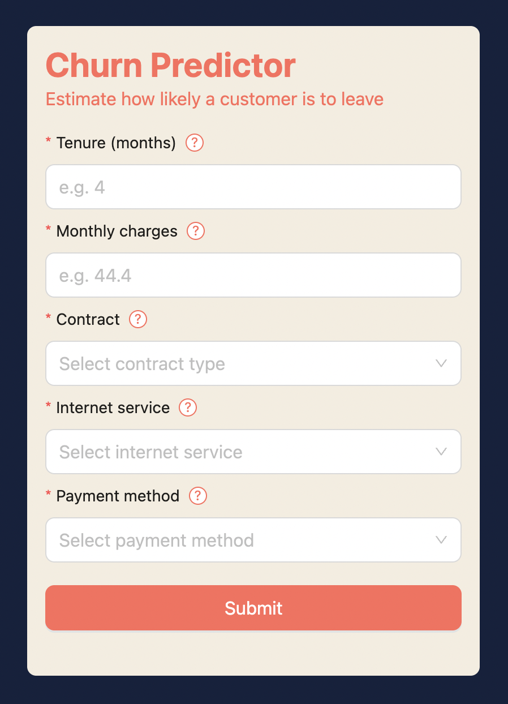

# Churn API

Predict the chance that a telecom customer will leave the company (churn).

A small, production-style ML app: a scikit-learn model behind a FastAPI API, with a React UI on top.

**Live demo:** https://churn-api.fastapicloud.dev/

**API docs:** https://churn-api.fastapicloud.dev/docs



## Features

- **Churn prediction API** — `POST /predict` returns the probability (0–1) that a customer will churn.
- **Web UI** — a React + TypeScript form with field hints and inline error messages, served by the same FastAPI app.
- **Strict input validation** — Pydantic checks types, ranges and allowed values. Bad requests get a clear `422` response.
- **Production-style model serving** — the whole scikit-learn pipeline (preprocessing + model) is saved as one file and loaded once at startup.
- **Reproducible training** — a training script with a fixed random seed, plus `metadata.json` with metrics, features and the scikit-learn version.
- **Tested** — API, ML and integration tests.
- **Resilient setup** — settings come from environment variables, and the API keeps working even if the UI is not built.
- **Docs and monitoring** — interactive Swagger UI at `/docs` and a `/health` endpoint.

## Model

### Why logistic regression

Before building this app, I compared many models on the same dataset:

- [Telco Churn Prediction — 5 Models Compared](https://www.kaggle.com/code/bekzhanborbekov/telco-churn-prediction-5-models-compared) — classic classification models
- [Telco Churn Prediction — Tree Methods Compared](https://www.kaggle.com/code/bekzhanborbekov/telco-churn-prediction-tree-methods-compared) — tree-based models, including boosting
  Logistic regression gave the best results in both comparisons. It is also simple, fast, very small (a few KB) and easy to explain. That makes it a great fit for an API.

### Features used

The model uses only 5 inputs:

| Feature            | Description                                                                          |
| ------------------ | ------------------------------------------------------------------------------------ |
| `tenure`           | Number of months the customer has stayed with the company                            |
| `monthly_charges`  | The amount charged to the customer monthly                                           |
| `contract`         | Month-to-month, One year or Two year                                                 |
| `internet_service` | DSL, Fiber optic or No                                                               |
| `payment_method`   | Electronic check, Mailed check, Bank transfer (automatic) or Credit card (automatic) |

I picked these 5 because they were the most important features in my boosting model (after adding up the one-hot columns of each feature).

Two features that look useful are left out on purpose:

- **TotalCharges** — it is almost the same as `tenure × MonthlyCharges`, so it repeats information we already have. It also has empty values for new customers.
- **gender** — it has almost no effect on churn, and using it to make decisions about customers is not a good practice.

### Results

| Metric                           | Value         |
| -------------------------------- | ------------- |
| ROC-AUC, 5-fold cross-validation | 0.836 ± 0.010 |
| ROC-AUC, test set (20%)          | 0.832         |
| F1 at threshold 0.5              | 0.556         |

With all features, my earlier notebook reached ROC-AUC 0.843 on a single test split. That is inside the cross-validation range above. So using only 5 inputs costs almost nothing in quality, but makes the API much simpler to use.

The API returns a probability, not a yes/no answer. The right threshold depends on the business. For example, a retention team may want to call every customer with a churn risk above 30%.

## Tech stack

- **Backend:** Python, FastAPI, Pydantic, pydantic-settings
- **ML:** scikit-learn, pandas, joblib
- **Frontend:** React, TypeScript, Vite
- **Tests:** pytest, FastAPI TestClient
- **Tooling:** uv
- **Deployment:** FastAPI Cloud

## Getting started

### Requirements

- [uv](https://docs.astral.sh/uv/) — installs Python and all dependencies
- [Node.js](https://nodejs.org/) — only needed for the UI

### Run the API

```bash
git clone https://github.com/Borbekov/churn-api.git
cd churn-api
uv sync
uv run fastapi dev app/main.py
```

Open http://127.0.0.1:8000/docs to try the API.

The trained model is already in `artifacts/`, so you don't need to train it to run the app.

### Run the UI

**Development mode** (with hot reload):

```bash
cd frontend
npm install
npm run dev
```

Open http://localhost:5173. Requests to `/predict` and `/health` are sent to the API on port 8000 through the Vite proxy.

**Single-server mode** (how it runs in production):

```bash
cd frontend && npm run build && cd ..
uv run fastapi dev app/main.py
```

Now FastAPI serves the UI at http://127.0.0.1:8000/. If the UI is not built, the API still works and writes a warning to the log.

### Retrain the model (optional)

1. Download the [Telco Customer Churn dataset](https://www.kaggle.com/datasets/blastchar/telco-customer-churn) from Kaggle.
2. Save the CSV file as `data/Telco-Customer-Churn.csv`.
3. Run:

```bash
uv run python scripts/train.py
```

The script prints the metrics and saves a new model and `metadata.json` to `artifacts/`.

## Disclaimer

The model is trained on a public sample dataset (IBM Telco Customer Churn). This is a learning project, not a tool for real business decisions.
